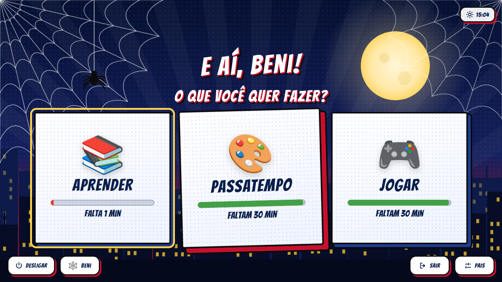
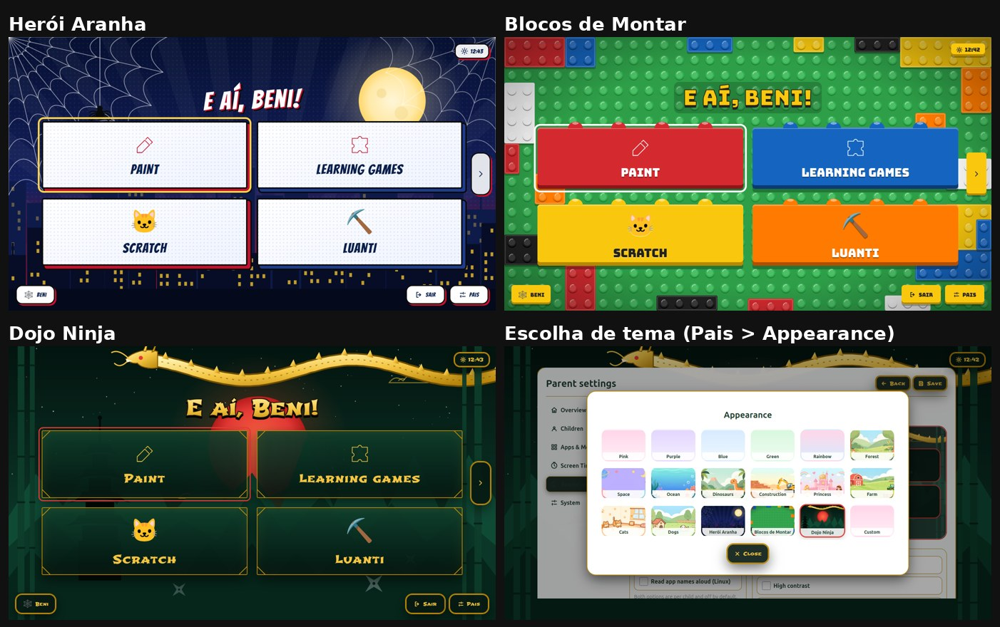
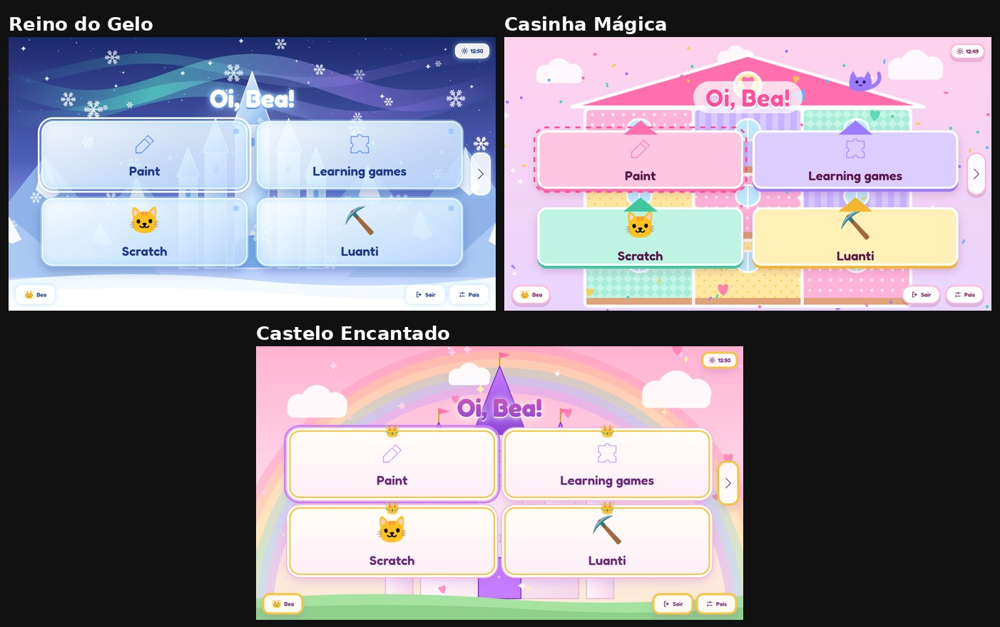
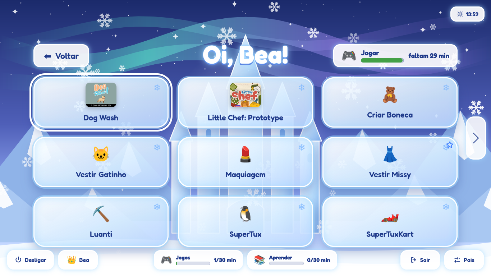
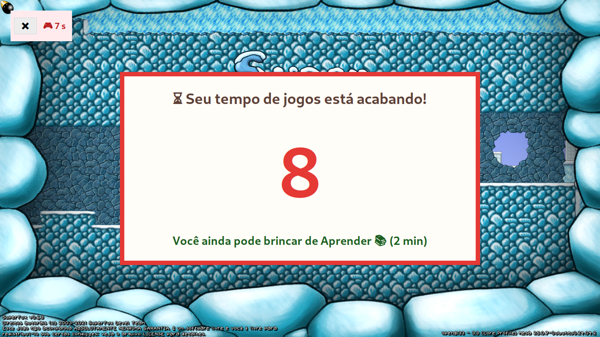
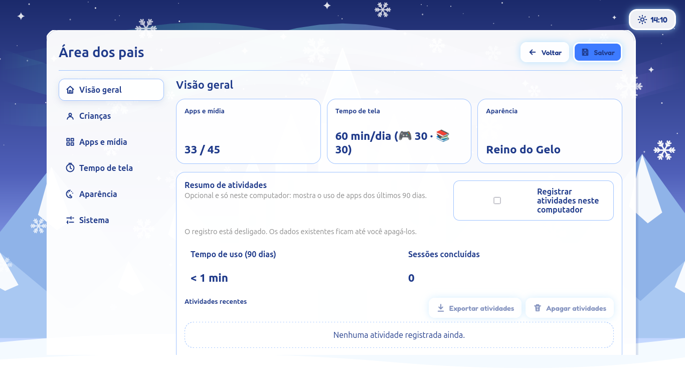
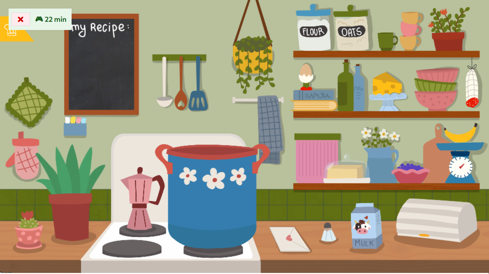
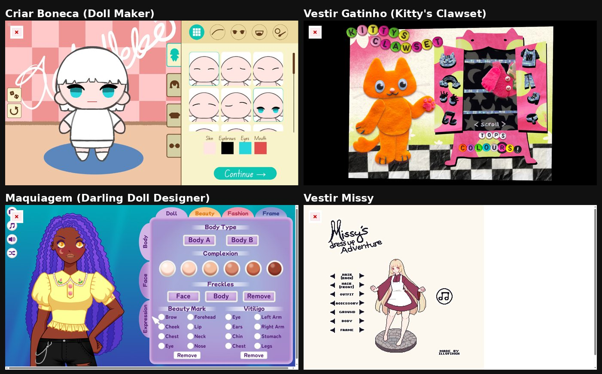
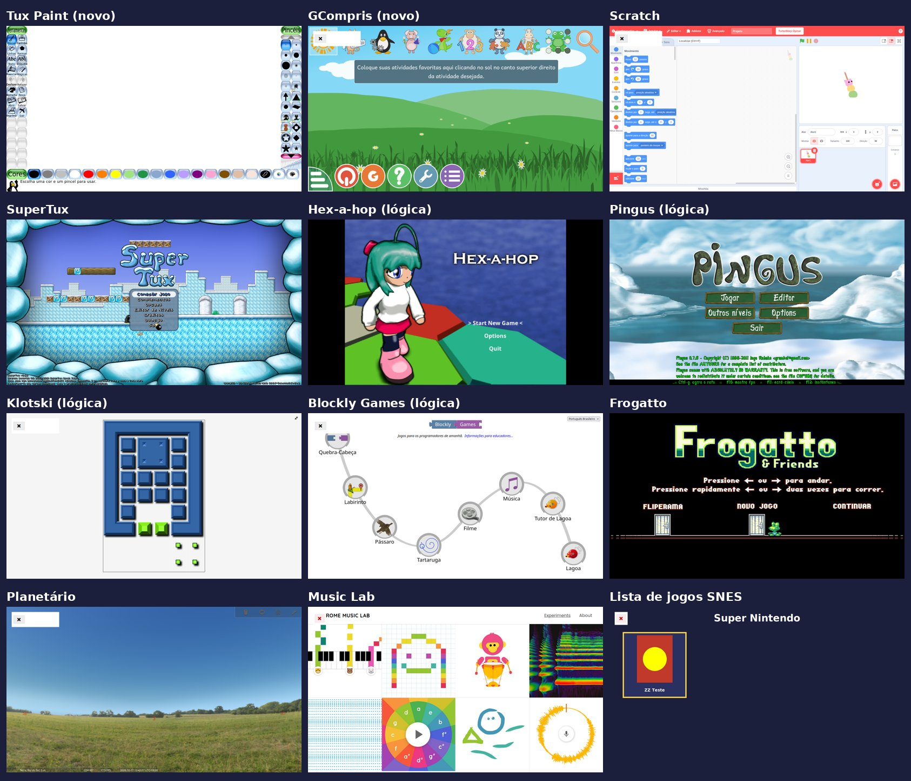

# Beni Launcher

Um menu infantil em tela cheia para notebooks antigos com Linux, pensado para crianças de 5 a 8 anos.
Ao ligar o notebook, a criança vê **"O que você quer fazer? 📚 Aprender / 🎨 Passatempo / 🎮 Jogar"**, escolhe, e só
encontra apps, jogos e sites aprovados pelos pais, com **limite de tempo diário por categoria**.



> **Este projeto é uma adaptação do [Cozy Kids Launcher](https://github.com/TrissyGE/cozy-kids-launcher)**,
> criado por Tristan e colaboradores (licença MIT). Todo o núcleo, como o servidor local, a
> supervisão dos apps, o botão ❌ por cima dos jogos, os perfis, o PIN dos pais e os horários,
> vem de lá. Este repositório parte da versão **0.6.0** (commit `91b7157`), mantém o histórico
> original e acrescenta as mudanças descritas abaixo, feitas para preparar dois notebooks antigos
> para duas crianças brasileiras (Beni, 8 anos, e Bea, 5 anos).
> O README original está em [README.original.md](README.original.md).

---

## O que mudou em relação ao original

### Para as crianças
- **Tela inicial "Aprender / Passatempo / Jogar"**: cartões grandes (Passatempo = desenhar, colorir e jogos educativos, dividindo o tempo com os Jogos), cada um com uma barrinha e "faltam 18 min". A lista mostra só a categoria escolhida, com botão **⬅ Voltar** (ou Esc). Quando a categoria esgota, o cartão fica cinza com 🔒 "Amanhã tem mais!".
- **Limite de tempo diário por categoria**: por exemplo, 60 min por dia, sendo 30 de jogos e 30 de atividades educativas.
  - Medidores verde/amarelo/vermelho no launcher e o tempo restante ao lado do ❌ durante o jogo.
  - Nos **10 segundos finais** aparece uma contagem grande ("Seu tempo de jogos está acabando! 8…"), com a sugestão do que ainda dá para fazer ("Você ainda pode brincar de Aprender (18 min)").
  - O tempo continua contando certo mesmo depois de reiniciar o notebook e zera à meia-noite.
- **6 temas novos**, com arte original em SVG (nenhum personagem ou logo de marca):
  - meninos: **Herói Aranha** (quadrinhos), **Blocos de Montar** e **Dojo Ninja**;
  - meninas: **Reino do Gelo**, **Casinha Mágica** e **Castelo Encantado**, com letras grandes e redondas para quem ainda está aprendendo a ler.
- **Interface toda em português do Brasil**: a tela das crianças e toda a área dos pais (novo idioma `pt`).
- **Apps melhores**:
  - GCompris em versão nova (Flathub) o Kleki para desenhar (no lugar do Tux Paint; os desenhos ficam em Imagens/Desenhos), o Autodraw e o Colorir (desenhos prontos para pintar, sem propaganda de outros jogos);
  - Scratch (TurboWarp), Luanti (parecido com Minecraft), Klavaro (digitação), Klotski, Pingus, Hex-a-hop, SuperTux, Frogatto e Stellarium;
  - sites educativos em português (Khan Academy, PhET com uma tela para escolher a matéria, Blockly Games, Escola Games sem anúncios e sem o menu de jogos de diversão);
  - jogos de vestir/maquiagem/boneca sem anúncios (itch.io).
- **Super Nintendo e PlayStation**: uma lista de jogos em tela cheia, com capas, que funciona com teclado, mouse ou controle. Usa RetroArch + snes9x e PCSX-Reloaded. Os jogos (ROMs) não vêm incluídos.
- **Jogos de navegador em tela cheia de verdade**: os jogos do itch.io são ampliados até ocupar a tela, a faixa do Unity com o botão "tela cheia" é escondida e uma tela "Carregando…" cobre a abertura, para não aparecer a área de trabalho piscando.

### Para os pais
- **Coleções do itch.io**: cada criança tem uma coleção pública no itch.io. Jogo que você adiciona na coleção vira ícone, com a capa, no perfil da criança, e jogo removido some. A sincronização roda no login e a cada 30 min. Os pais testam o jogo antes e só então distribuem.
- Em Pais → Tempo de tela → **Limite diário por categoria** você define os minutos (também diferentes em cada dia da semana, por exemplo mais jogo no fim de semana), escolhe a categoria de cada app e zera o tempo do dia.
- **Login automático no Khan Academy**: em Pais → Crianças → "🔑 Login automático nos sites" você salva o e-mail e a senha da conta da criança; ao abrir o Khan, o launcher entra sozinho. Cada criança tem o seu navegador de sites, então os logins não se misturam.
- **Internet com filtro**: o notebook usa o DNS CleanBrowsing Family em qualquer Wi‑Fi. Sites adultos, proxies e VPNs ficam bloqueados, e a Busca Segura do Google e o Modo Restrito do YouTube são obrigatórios.
- Em Pais → Aparência → **Tela inicial** você liga ou desliga a pergunta Aprender/Passatempo/Jogar em cada perfil.
- A prévia da aparência mostra o visual dos temas novos e as capas dos jogos.

### Correções para notebooks antigos e jogos "rebeldes"
| Problema | Solução |
|---|---|
| Nenhum app abria (o ❌ por cima falhava) | `python3-tk` passa a ser instalado |
| GCompris não abria (`gcompris` × `gcompris-qt`) | atalho `beni/bin/gcompris` |
| TuxMath, Pingus etc. **prendiam o mouse** e o ❌ não funcionava | `nograb.so` (LD_PRELOAD) anula o "prender mouse" do SDL 1.2/SDL2 |
| SuperTuxKart trocava a resolução e **a tela ficava apagada** ao fechar | os atalhos sempre usam a resolução atual da tela |
| Apps que abrem em janela (Scratch, Klavaro, Klotski) | `cozy-fullscreen` coloca em tela cheia via `wmctrl` |
| Ctrl+Alt+Del bloqueava a tela, e ao voltar ficava preta | atalho e bloqueios automáticos desligados |
| Barra do Linux aparecia ao abrir jogos | painéis do XFCE escondidos (aparecem com o mouse na borda) |
| Linha vertical piscando no launcher (F7 do Firefox) | navegação com cursor desligada |
| Esc numa mensagem de "tempo acabou" saía do modo infantil | agora Esc só fecha a mensagem |
| Jogos 3D de navegador lentos no Firefox | jogos de navegador abrem no Chromium com aceleração forçada (≈2× mais FPS neste hardware) |

A lista detalhada, arquivo por arquivo, está em [beni/MUDANCAS.md](beni/MUDANCAS.md).

---

## Ambiente em que foi feito e testado

| | |
|---|---|
| Notebook | Samsung RV419/RV420 (≈2011) |
| Processador | Intel Celeron B800 1.5 GHz, 2 núcleos |
| Memória | 2,8 GB |
| Vídeo | Intel HD Graphics 2000 (Sandy Bridge), OpenGL 3.3 (Mesa 25.0) |
| Tela | 1366×768 |
| Rede | Atheros AR9285 (só Wi-Fi, **sem Bluetooth**) |
| Sistema | **Linux Mint 22.3 "Zena" XFCE** (base Ubuntu 24.04), kernel 6.14, sessão X11 |
| Navegadores | Firefox 146 (launcher e sites) · Chromium 155 via Flathub (jogos de navegador) |
| Python | 3.12 |

**Requisitos:** Linux Mint XFCE ou outra distro baseada em Ubuntu 24.04 com XFCE, sessão **X11**
(não Wayland), internet na instalação e um usuário comum para a criança, com login automático.
Em Mint Cinnamon/MATE quase tudo funciona, mas os ajustes de barra/bloqueio são específicos do XFCE.

---

## Instalação num notebook novo

1. Instale o **Linux Mint XFCE**, crie o usuário e ative o **login automático**.
2. Baixe este repositório e rode o instalador **como o usuário da criança** (sem `sudo`; ele pede a senha quando precisa):
   ```bash
   git clone https://github.com/jaison/beni-launcher.git
   cd beni-launcher
   ./instalar.sh
   ```
   São uns 2–3 GB de downloads: apps do Flathub, Chromium e emuladores.
3. Saia da sessão e entre de novo. O launcher abre sozinho.
4. **Antes de entregar** para a criança:
   - **Pais → Sistema: crie o PIN dos pais.** Sem PIN, qualquer um entra no painel, sai do modo infantil ou zera o tempo.
   - Ajuste nomes, temas e limites em Pais. A configuração inicial traz dois perfis de exemplo, com os apps já separados em Aprender/Passatempo/Jogos.
   - Luanti: abra uma vez e instale o jogo **Mineclonia** (Conteúdo → Procurar).
   - Coloque seus jogos de SNES/PS1 em `~/Jogos/SNES` e `~/Jogos/PS1`. A BIOS do PS1 vai em `~/Jogos/PS1/BIOS` (veja `~/Jogos/LEIA-ME.txt`).
   - Troque as coleções do itch.io em `~/.config/cozy-kids-launcher/itch-colecoes.json`. O arquivo liga o **id do perfil** à URL pública da coleção.

Rodar `./instalar.sh` de novo atualiza os arquivos e **não apaga** a configuração nem os jogos.
Use `./instalar.sh --sem-apps` para atualizar só o launcher, sem apt/flatpak.

---

## Como funciona (resumo técnico)

```
login → ~/.config/autostart → cozy-iniciar
          ├─ cozy-itch-sync      (lê as coleções do itch.io → tiles "itch-*" no config.json)
          └─ cozy-kids-launcher  (servidor Python em 127.0.0.1:38431 + Firefox em modo quiosque)
                 └─ tocar num ícone → process_supervisor.py + overlay.py (❌ e tempo restante)
                        ├─ apps locais: atalhos em ~/.local/bin (tuxpaint, supertux, …)
                        ├─ sites: Firefox em modo quiosque
                        └─ jogos de navegador: navegador-jogos → Chromium em modo quiosque
                               → cozy-jogo.html (amplia o jogo) + carregando.py (tela de espera)
```

| Onde | O quê |
|---|---|
| `src/` | código do launcher (original + mudanças) → `~/.local/share/cozy-kids-launcher` |
| `src/usage_limits.py`, `src/frontend/usage-limits.*` | limites por categoria |
| `src/frontend/escolha.*` | tela Aprender/Passatempo/Jogar |
| `src/frontend/cozy-temas.css`, `themes/*.svg`, `themes/fonts/` | temas novos |
| `src/frontend/locales/pt.json` | tradução |
| `beni/bin/` | atalhos dos apps, `cozy-itch-sync`, `navegador-jogos`, `cozy-iniciar` … → `~/.local/bin` |
| `beni/lib/cozy-fixes/` | `nograb.c` (compilado na instalação) e `carregando.py` |
| `beni/cozy-jogos/jogos.py` | lista de jogos SNES/PS1 |
| `beni/chromium/cozy-jogo.html` | moldura que amplia jogos de navegador |
| `beni/config/` | configuração inicial (perfis, apps, categorias, limites) e coleções do itch.io |
| `beni/emuladores/` | configurações do RetroArch, PCSX-R e Luanti para hardware fraco |
| `beni/systemd/` | timer da sincronização do itch.io |
| `beni/ferramentas/` | scripts que geram os SVG dos temas |

O código ainda usa os nomes internos do original (`cozy-kids-launcher`, porta 38431, pastas em
`~/.local/share/cozy-kids-launcher`). Assim fica fácil comparar com o projeto original e trazer
correções de lá.

### Testes
Os 277 testes automáticos do projeto original passam (`python3 -m unittest discover -s tests`).
Três testes foram ajustados ao comportamento novo: textos já traduzidos no `index.html` e o campo
`limitBlocked` na resposta de disponibilidade.

---

## Limitações conhecidas
- Jogos de navegador demoram 10 a 50 s para abrir num Celeron. Jogos 3D pesados (alguns do Universo Rabisco) ficam abaixo de 10 FPS e foram escondidos.
- O emulador de PS1 (PCSX-R) é antigo. O core `pcsx_rearmed` do RetroArch seria melhor, mas não está nos repositórios do Ubuntu.
- O `src/index.html` (e outros arquivos com textos) deste repositório já vem "renderizado" em pt-BR, não é mais um modelo com `{{…}}`. O `scripts/install.sh` original continua funcionando (foi ajustado para copiar os arquivos novos), mas o caminho recomendado é o `instalar.sh`.
- Sem PIN configurado, a área dos pais fica aberta.
- ROMs comerciais não são fornecidas. Use cópias dos seus próprios discos/cartuchos ou jogos homebrew.

## Créditos e licenças
- **[Cozy Kids Launcher](https://github.com/TrissyGE/cozy-kids-launcher)** © 2026 Tristan e colaboradores, **licença MIT**. Ela continua valendo para todo o código ([LICENSE](LICENSE)). As mudanças deste fork são publicadas sob a mesma licença.
- Fontes dos temas (Bangers, Bungee, Shojumaru, Fredoka): SIL Open Font License, veja [themes/fonts/LEIA-ME.md](themes/fonts/LEIA-ME.md).
- Os apps e jogos instalados (GCompris, Tux Paint, TurboWarp, Luanti, SuperTux…) e os jogos do itch.io pertencem aos seus autores e só são baixados das fontes oficiais.
- Adaptação feita com a ajuda do Claude (Anthropic) via Claude Code.

## Galeria
| | |
|---|---|
|  |  |
|  |  |
|  |  |
|  |  |
